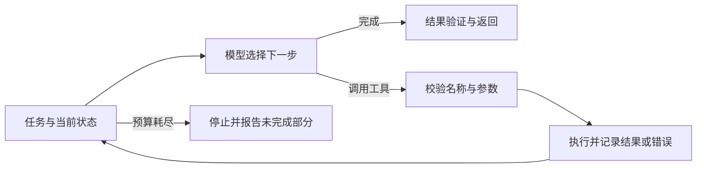

# D｜Agent、搜索与后训练

更新：2026-10-20，新增基础讲解。P0：D01、02、03、04、05、06、10、14。先通过工具调用的小例子理解系统如何运行，再进入问答。

## 知识地图

| 层次 | 内容 | 首轮准备程度 |
|---|---|---|
| 基本系统 | 模型、状态、工具、观察、循环、停止／错误恢复 | 能画图并写一个模拟循环 |
| 工具与数据 | 参数 schema、结构化输出、执行校验、日志、超时、重试、幂等 | 能解释一次调用全过程，不先依赖框架名 |
| RAG／记忆 | 分块、召回、重排、引用、上下文、任务状态、长期记忆 | 分开分析检索与生成失败 |
| 规划／搜索 | ReAct、计划与执行、BFS／A*、MCTS／PUCT、模拟器条件 | 解释预算、价值与反馈偏差 |
| 评价 | 任务成功、过程错误、成本、重复运行、judge／verifier、pass@k | 设计冻结的配对评价与错误切片 |
| 学习 | MDP、回报、价值／优势、策略梯度、PPO／DPO／GRPO | 先理解数据、目标、更新对象，再看公式 |
| 程序进化 | 生成、执行、验证、筛选、局部修订、保留集与遗忘 | 联系 4a 最新证据，不把原型等同已验证收益 |

## 基础知识：从一次工具调用理解 Agent

前置只需要知道语言模型接收输入、输出 token，以及程序能执行函数。第一次读到 PPO／DPO／GRPO 等缩写，可以先看本节末尾的直觉说明，暂不推损失公式。

### 基础 D-1｜语言模型在整个系统里负责什么

**LLM，大语言模型**接收可见的输入，生成后续内容。**prompt，提示／输入**可以包括任务、要求、示例、历史信息和工具说明。模型输出既可以是自然语言答案，也可以按约定写成工具调用请求。

在本材料里，**Agent**指让模型参与选择下一步操作、并根据操作结果继续处理任务的系统。系统还包括运行程序、状态、工具、日志、预算与结果检查。**Agent 的行为**由模型与这些系统组件共同决定。

例如模型输出“调用乘法函数”，实际乘法仍由程序负责执行。需要看真实执行结果，才能判断这一步完成了什么。

### 基础 D-2｜先走一遍完整例子

任务是“计算 $2+3\times4$”。假设系统提供两个工具：`multiply(a,b)` 和 `add(a,b)`。下面是教学模拟，不代表已经调用某个真实模型：

| 步骤 | 模型或程序做什么 | 得到什么 |
|---|---|---|
| 1 | 模型根据任务请求 `multiply(3,4)` | 一条调用请求 |
| 2 | 运行程序检查工具名和参数，然后执行函数 | 结果 12 |
| 3 | 程序把结果写回模型可见的历史 | 模型知道本次调用返回 12 |
| 4 | 模型请求 `add(2,12)` | 第二条调用请求 |
| 5 | 程序执行并返回 14 | 新观察 |
| 6 | 模型输出最终答案 14，系统按规则检查并结束 | 一次完整任务 |

**动作 action**是执行选择，**观察 observation**是操作后返回的信息。**轨迹 trajectory**记录任务中发生过的输入、动作、观察和结果。**执行循环 loop**是这个过程重复推进的控制方式。

从例子先记住：调用请求、真实执行、观察返回是三个步骤。只看到第一步，不能推断第二步已经发生。

### 基础 D-3｜Function Calling、JSON 与 schema

**Function Calling／Tool Calling**是让模型用可解析形式提出函数／工具调用请求。工具通常包含名称、用途和参数说明。

**JSON**是一种表示结构化数据的文本格式，例如：

```json
{"tool":"multiply","arguments":{"a":3,"b":4}}
```

这里 `tool` 是键，`multiply` 是值；`arguments` 中有两个参数。**schema**约定哪些字段必须存在、类型和取值范围是什么。上面是自定义教学格式，具体厂商接口有各自的消息结构。

程序要检查：工具是否存在、a/b 是否是允许的数值、参数是否缺失、执行是否报错；还要让结果对应到原调用。模型写出的字符串需要经过这些环节，才能成为有效工具执行。

### 基础 D-4｜工作流、状态、框架与停止条件

**工作流 workflow**预先规定主要步骤，比如先查资料，再抽取字段，最后生成报告。**自主决策**允许模型根据当前信息选择后续步骤；两者可以混合。

**状态 state**在系统实现里可指保存的任务进度，如已查到的数据、待办步骤、最近调用和错误。**运行器／宿主程序**负责调模型、执行工具、更新状态并检查是否继续。

**框架 framework**如 LangChain／LangGraph 提供组织工具、消息、状态和控制流程的组件。理解流程之后再学框架，会更容易分清哪些工作由它代劳。

系统要定义最大步数、时间／费用限制、错误后的处理和结束规则。**重试 retry**是失败后再次尝试；**超时 timeout**是等待达到期限后返回失败；**幂等 idempotent**指相同操作重复执行仍具有规定的同一效果，涉及副作用的重试必须检查它。

### 基础 D-5｜RAG：先找资料，再基于资料回答

**RAG，检索增强生成**把外部资料检索和模型回答连接起来。教学例：笔记写着“实验 A 每步使用 100 次模拟”，问题是“实验 A 的搜索预算是什么”。系统先找出该段笔记，再让模型基于它回答。

| 环节 | 在做什么 |
|---|---|
| 分块 chunking | 将长文档分成便于检索的片段，尽量保留相关上下文 |
| 索引 index | 将片段组织起来，使查询能较快找到候选 |
| 召回 retrieval | 根据查询挑出可能相关的片段 |
| 重排 reranking | 对候选作更细的相关性判断并重新排序 |
| 上下文组装 | 选择要实际提供给模型的证据，并保留来源 |
| 生成 generation | 基于任务与证据形成答案 |

**关键词检索**利用词项匹配；**向量检索**将查询与片段表示为向量，再计算相似性；**embedding**的基本含义见基础 C-8。相似性有助于找候选，需要再检查证据是否真的回答问题。

### 基础 D-6｜上下文、记忆与证据来源

**上下文 context**是模型这一次调用能看到的内容。**上下文窗口**限制一次能处理的信息量，常以 token 数计。

**任务状态**可以由程序保存，即使不全部塞进本次输入也仍存在。**长期记忆 memory**保存跨轮可能有用的信息，需要决定记什么、何时取回、怎样修正过时内容。

例如笔记存在本地文档中，是一个信息来源；检索到的片段进入本次上下文后，模型才看得到它。一次对话加入新资料，不会因此自动更新模型参数。

**摘要／上下文压缩**用更短表示保留必要信息，会有遗漏或失真的风险。程序中的真实状态、工具返回、模型生成的推测要保留来源，便于排错。

### 基础 D-7｜规划、执行、反思和搜索

**规划 planning**提出完成任务的步骤。**执行 execution**实际做这些操作。例：先算乘法再算加法是计划，工具返回 12、14 是执行过程中的观察。

**ReAct**是一类将决策依据、动作与观察交错组织的方法；**反思 reflection**根据失败提出修正假设，比如“先前漏掉了一个约束”。修正是否有用，需要执行和评价验证。

**搜索 search**显式考虑多个候选。例如游戏状态下可以尝试上、下、左、右，再比较后果。候选形成分支，连续操作形成路径。搜索需要考虑分支数和尝试成本。

**模拟器 simulator**按环境规则预测操作后会发生什么。有可复制、可回滚的可信模拟器时，可以在内部比较路径；真实操作不可回滚或规则未知时，必须改变相应方法与假设。

### 基础 D-8｜MCTS 为什么会“多尝试一些方向”

**MCTS，蒙特卡洛树搜索**通过有限次数的模拟逐步积累信息。可以先理解为四步循环：选择一条值得尝试的分支，扩展尚未充分探索的部分，用模拟或价值估计评价，最后把结果回传到路径上的统计量。

假设动作 A 尝试 10 次赢 6 次，动作 B 尝试 2 次赢 1 次。直接根据当前成功比例可能更偏向 A；但 B 的样本少，也可能值得继续尝试。

- **利用 exploitation**：更多选择当前看起来好的方向。
- **探索 exploration**：花预算了解尚不确定的方向。
- **访问次数 N**：相应分支被搜索多少次。
- **价值估计 Q**：对该分支后续表现的估计；具体可能是均值或其他有明确定义的量。
- **先验 P**：搜索开始前对动作的偏好，可来自模型或规则。

**UCT／PUCT**是平衡这些信息的选择规则，PUCT 引入先验偏好。先理解它们要平衡什么，完整公式留到 D14。有限尝试得到的好路径或评分，仍可能有偏差。

### 基础 D-9｜奖励、回报、策略、价值与优势

**奖励 reward**是某一步的反馈数值。**回报 return**把后续多步奖励按规定累加。**折扣因子 γ**控制后续奖励的权重：两步奖励分别是 -0.1、1，γ=0.9，则起点回报是 $-0.1+0.9\times1=0.8$。

**策略 policy，π**描述在当前状态怎样选动作，可以是确定规则，也可以是各动作的概率。**rollout**是按某策略运行得到一条轨迹，模型训练和树搜索的具体采样方式可能不同。

**价值 V**是在某状态、按指定策略继续的期望回报；**动作价值 Q**还指定第一个动作。**优势 A**比较该动作相对当前策略平均水平好多少，常写作 $A=Q-V$。

教学例：同一状态两个动作的 Q 分别为 2、6，策略各选一半，V 就是 4，两动作优势分别为 -2、+2。这是给定策略下的期望量，不是一次运行结果必然等于 2 或 6。

### 基础 D-10｜强化学习在更新什么，PPO／DPO／GRPO 先怎样认识

**强化学习 RL**利用行动及奖励等反馈调整策略，希望提高相应任务回报。若策略由神经网络表示，可以更新网络参数；若当前方法只调整外部组合权重或程序库，要明确其实际更新对象。

**策略梯度**根据采样结果估计参数怎样调整有助于提高回报。**baseline**提供参照，帮助减小某些估计的波动；**critic／价值模型**估计状态／动作价值，常用于辅助策略学习。

| 方法 | 第一层直觉 | 接下来再学什么 |
|---|---|---|
| SFT | 学习示范中给出的输出或行为 | 训练数据、目标 token 与 loss mask |
| PPO | 用采样反馈改策略，并限制某些过大更新的激励 | 概率比、优势、裁剪与价值估计 |
| DPO | 原始离线流程利用同题的偏好回答对调整策略 | 偏好损失、参考策略与数据覆盖 |
| GRPO | 同一题采一组回答，以组内奖励作相对评价 | 组标准化、策略目标、KL 与零差异问题 |

**偏好对**是同一输入下哪个回答更受偏好的标注；**参考策略**提供一个比较／约束的基准。它们与 AUC、准确率等评价指标的角色不同。第一遍能说明“用什么数据、改什么、怎样检查”即可。

### 基础 D-11｜评价器、成功率与 reward hacking

**verifier，验证器**按规则或程序检查结果；**judge，评判器**给回答打分或比较，可能由人或模型承担。它们都需要验证是否覆盖真正的目标。

假设奖励只检查输出里有没有“完成”两个字，模型反复输出“完成”就可能拿到高奖励，却没有做成任务。这类利用评分缺口的行为叫 **reward hacking，奖励投机**。

**成功率**统计按任务定义通过的比例；还应看工具错误、超时、调用次数和费用。**benchmark，基准评测**是一套约定的任务、环境和评分协议，不只是一个榜单数字。

**pass@k**关注 k 个候选里是否至少有一个正确；若其中一个正确，但最终选错了，候选覆盖与选择后的成功率仍是两项不同结果。公式与估计前提见 D12。

### 基础 D-12｜程序进化、保留数据与模型训练

**程序／提示进化**可以先理解为：生成候选，执行评价，保留或拒绝，再尝试修订。**补丁 patch**是对一部分程序的修改；**策略库**可存放多个可执行决策组件。

先明确变化发生在哪里：改 prompt、替换程序、调整组合权重、更新模型参数，是不同的更新操作。每种操作都需要对应的比较与成本记录。

**保留数据**是在某一选择阶段不用于提案／拟合、用来检查候选的实例。长期反复依据它修改，也会使它承担开发数据的角色。局部评分改善，还需要完整任务验证；程序能运行也要继续检查建议是否有效。

### 基础 D-13｜把剩余术语放到正确位置

| 术语 | 第一层理解 |
|---|---|
| MDP | 给定当前状态与动作，下一步转移／奖励分布不再需要更早历史的一类决策建模 |
| 部分可观测 | 当前只得到环境的一部分信息，历史或记忆可能有用 |
| 多 Agent | 多个决策角色协作或分工，需要调度与冲突处理 |
| 日志／trace | 保存具体输入、动作、输出、耗时和错误，支持复查 |
| 数据／测试污染 | 评价信息进入了学习或选择，使评测失去原来的独立性 |
| 冻结评测 | 检查方案时保持模型／程序／选择规则等相关部分固定 |
| 消融 | 拿掉或替换某组件，观察对表现与成本的影响 |

### 基础 D-14｜先用三个问题检查理解

1. 模型写出 `multiply(3,4)` 后，哪部分真正得到 12？答：宿主程序执行真实工具，并把结果作为观察返回。
2. 文档里答案没进入上下文，与证据已经提供但模型没用对，是同一种失败吗？答：分别检查检索／上下文组装与生成／使用证据的环节。
3. 多试几次找到一个好答案，是否说明策略参数已经学会？答：先检查是否发生参数更新；更多采样的收益与学习后的收益应分别评价。

先能画出任务—模型决策—工具执行—观察返回的循环，再做 D01—D06；MCTS 可以接着基础 A-4／D-8 学，后训练公式放在第二遍。

## 20 道典型问答

### D01 [P0] Agent 与工作流有什么区别？什么时候选哪种？

工作流通常由程序预先规定主要控制路径；Agent 让模型在运行中选择下一步操作或工具。二者可以混合：固定流程中嵌入局部自主决策。稳定任务往往先考虑可控流程；需要动态判断和多步环境交互时再评估自主循环。

评价实际任务成功、成本与稳定性，不根据命名判断系统强弱。[官方工作流与 Agent 说明](https://docs.langchain.com/oss/python/langgraph/workflows-agents)

### D02 [P0] 最小 Agent 循环包含什么？怎样终止？

至少包括任务／状态、模型决策、合法工具执行、观察写回和结果检查。停止条件应由程序同时约束：模型完成、验证通过、最大步数／时间／费用、不可恢复错误；不能无限依赖模型主动停下。



追问：哪些状态持久化，失败后从哪步恢复，怎样防止反复做同一件事？

### D03 [P0] Function Calling 是怎样执行的？JSON 合法就够了吗？

程序向模型提供工具描述和参数结构；模型输出调用名称／参数；宿主程序校验并调用真实函数；结果按调用标识关联后写回上下文，再继续决策。具体消息格式取决于所用接口。

学习时可自定义模拟结构 `{"tool":"add","arguments":{"a":2,"b":3}}`，程序执行得到 5 后再作为观察返回。这个 JSON 只是练习协议，不是某个厂商 API 的直接请求格式。

JSON 语法合法不代表工具存在、参数类型／范围正确或操作可成功；需要程序校验、可观察错误和适当权限。涉及副作用的重试要考虑幂等，不能把失败后再次执行当作总是安全。工具 schema 与真实执行是两个环节，不先要求你掌握 LangChain。

### D04 [P0] RAG 的完整链路是什么？什么情况下优先考虑它？

离线整理文档、分块、建立检索索引；在线对查询召回、可选重排、选择上下文，再生成答案与引用。稀疏检索、向量检索或混合方式各有适用性；embedding 相似不等于证据必然正确。

适合知识需要更新、来源需要追溯、参数中不包含所需信息等场景。它不自动教会模型新技能，也不保证按证据作答。[RAG 原始论文](https://arxiv.org/abs/2005.11401)

### D05 [P0] RAG 效果不好，怎样区分检索与生成问题？

先看目标证据是否存在、分块是否保留必要信息、是否进入候选／重排／最终上下文，再看模型是否正确使用证据。按标注定义 Recall@k、排序指标、答案正确性、引用支持度与时延；不要把检索 recall 和回答准确率混写。

可用已知正确证据作 oracle-context 诊断：若此时仍答错，生成／提示等问题值得重点排查；改善并不证明原检索已经足够。检查多跳问题、冲突证据和无答案任务。

### D06 [P0] ReAct、先计划再执行、反思和树搜索怎样区别？

ReAct 交错决策依据与动作，用环境观察推进下一步；先计划再执行先形成步骤，再根据反馈调整；反思提出失败原因与修订建议；树搜索显式展开候选并评价／选择。它们可以组合，不能只凭“多思考几步”认定收益。

反思文本是待检验假设；需要确认修改真的发生、在哪些保留任务上有用、额外调用是否公平。ReAct 机制参考[作者论文](https://arxiv.org/abs/2210.03629)，不要求背其整条示例推理。

### D07 [P1] 多 Agent 一定比单 Agent 强吗？

角色分工或并行探索可能有帮助，也会增加通信、重复工作、错误传播与费用。比较应固定总 token／调用／时间等相关预算，并与更强的单 Agent、并行独立采样和 verifier 方案对照。

明确谁调度、共享什么状态、冲突怎样仲裁，以及如何终止。由同一模型复制角色不代表独立信息来源或错误独立。

### D08 [P1] 短期上下文、任务状态和长期记忆有什么区别？

上下文是本次推理可见内容；任务状态是可恢复的结构化进度／环境信息；长期记忆保存跨轮可复用信息，需要写入、检索、更新与失效规则。历史对话并不自动成为可靠长期记忆。

评价记忆是否改善新任务、是否引入过时信息、是否把测试答案写回。压缩要保留工具结果、约束和未完成事项，不能只追求摘要短。

### D09 [P1] 工具输出含错误指令或上下文太长，怎样处理？

将网页／工具返回视为待用数据，保留其来源，系统控制与工具执行边界由程序约束；不能仅靠一句 prompt 保证模型始终区分指令与数据。工具白名单、参数检查、隔离执行、必要的人类审批等应按实际操作配置。

长上下文可用结构化状态、相关片段检索和摘要，但需测遗漏、引用和决策质量；不能只看 token 下降。对重复工具错误设置有限重试和明确停止。

### D10 [P0] 怎样设计 Agent 评测？成功率够不够？

冻结任务、模型／系统版本、prompt 和选择规则；定义任务成功以及可复核的评分条件。分开统计格式合法、工具执行、部分进度、最终成功与失败类型，同时报告 token、调用、搜索／环境交互、时延和费用。

开发任务可用于修改，最终测试留作冻结评价；按任务类型、长度和难度切片。等预算配对，并解释重复种子／多次训练分别代表什么随机性。单状态程序加速不能直接写为整任务加速。

### D11 [P1] LLM Judge 与可验证奖励有哪些局限？

LLM Judge 可能受表述、顺序、长度和自身偏好影响；程序 verifier 也可能只覆盖有限属性、存在错误或被投机利用。用人工核查子集、交换候选顺序、明确 rubric、检查不一致和失败切片进行验证。

不要把评价器分数提高当成真实目标必然改善。可执行、单元测试通过、业务任务完成分别对应不同层级的证据。

### D12 [P1] pass@1、pass@k 与最终选出的答案成功率有什么不同？

pass@k 衡量 k 个候选中至少一个正确的概率／相应估计。若一任务生成 n 个候选，其中 c 个通过，n≥k，均匀无放回选 k 个时“至少一个通过”的比例为

$$1-\frac{\binom{n-c}{k}}{\binom nk}.$$

在标准采样设定下可用它估计模型的 pass@k；若候选生成强相关、自适应或条件变化，需重审估计前提。它不是 verifier 最终选中的答案成功率；比较还要对齐候选预算。[代码评测论文](https://arxiv.org/abs/2107.03374)

### D13 [P1] MDP、价值和优势是什么？LLM Agent 都是完全可观测 MDP 吗？

MDP 包含状态、动作、转移、奖励及折扣等；Markov 性要求当前状态已包含预测后续所需的信息。$V^\pi(s)$ 为给定策略下的期望回报，$Q^\pi(s,a)$ 还固定首动作，$A^\pi(s,a)=Q^\pi(s,a)-V^\pi(s)$。

Bellman 关系为 $V^\pi(s)=E_{a,s'}[r+\gamma V^\pi(s')]$。实际 Agent 常只能观察部分信息，历史或状态摘要不一定构成完整 Markov 状态；模拟器可回滚、转移已知也不是所有任务共有条件。[课程背景](https://cs229.stanford.edu/main_notes.pdf)

### D14 [P0] MCTS 四个阶段是什么？UCT 与 PUCT 有什么区别？

常见过程为选择、扩展、模拟／价值评价、回传。UCT 使用估计价值和随访问次数变化的探索项；PUCT 将先验 P 融入探索，例如选择最大

$$Q(s,a)+cP(s,a)\frac{\sqrt{N(s)}}{1+N(s,a)}.$$

需说明 Q 是哪种估计、N 如何计数、未访问动作怎样初始化。单智能体累计回报常按 $G=r+\gamma G'$ 回传，终局续程为 0 时，终局奖励存在哪条边要一致，避免重复计入。

真实执行可能选最大根访问数，与选择公式不是同一步。先验可能有害；未知规则／不可回滚环境需要学习模型或限制搜索，不能直接假定准确模拟。先验引导搜索的例子见 [AlphaZero 原论文](https://arxiv.org/abs/1712.01815)。

### D15 [P1] REINFORCE 为什么能学习？baseline 为什么不改变期望梯度？

以无折扣有限回合为例，在相应可微与采样条件下，策略梯度可写成 $E[\sum_t\nabla_\theta\log\pi_\theta(a_t\mid s_t)\,G_t]$，$G_t$ 为后续回报。对不依赖当前采样动作的 baseline b(s)，有 $E_a[\nabla\log\pi(a\mid s)b(s)]=b(s)\nabla\sum_a\pi(a\mid s)=0$，所以可减去它降方差。

实际 surrogate 更新中，优势目标通常停止梯度；任意依赖动作的 baseline 不能直接套上式。Actor-Critic 用价值估计辅助学习，产生偏差／方差权衡。on-policy／off-policy 区分采样策略与被优化策略，数据复用要考虑偏差或校正。

### D16 [P1] PPO 的概率比和裁剪目标是什么？

定义 $r_t(\theta)=\pi_\theta(a_t\mid s_t)/\pi_{old}(a_t\mid s_t)$，PPO-Clip 的策略部分最大化

$$E_t\left[\min\big(r_tA_t,\operatorname{clip}(r_t,1-\epsilon,1+\epsilon)A_t\big)\right].$$

它限制某些方向上继续扩大更新的激励，并非硬性保证所有概率比都在区间内，也不保证 KL 永不超限。完整训练还可能含价值、熵等项；需解释 rollout、优势估计、旧策略固定和多轮优化。[原论文](https://arxiv.org/abs/1707.06347)

### D17 [P1] DPO 使用什么数据？与 PPO 有什么区别？

原始 DPO 用同一输入的偏好对 $(x,y_w,y_l)$ 和参考策略，通过策略相对参考的 log 概率比构造偏好损失：

$$-\log\sigma\left(\beta\left[\log\frac{\pi_\theta(y_w\mid x)}{\pi_{ref}(y_w\mid x)}-\log\frac{\pi_\theta(y_l\mid x)}{\pi_{ref}(y_l\mid x)}\right]\right).$$

它利用 KL 正则化偏好问题的推导，原始离线流程不需要显式训练奖励模型再用 PPO rollout 优化。偏好数据质量、覆盖与参考策略仍重要，不能概括成“完全没有奖励含义”或“总是比 PPO 好”。[DPO 论文](https://arxiv.org/html/2305.18290v3)

### D18 [P1] GRPO 的“组相对”是什么？有什么失败情况？

原始 DeepSeekMath GRPO 对同一问题从旧策略采一组回答，以组奖励估计 baseline，避免单独的 critic。结果监督将奖励减去组均值再除以组标准差；实现中常加稳定项，写作 $\hat A_i=(r_i-\bar r)/(\operatorname{std}(r)+\epsilon)$，结合裁剪的策略项与相应 KL 约束。

同组奖励全相同时没有相对偏好信号，标准差为 0 需跳过或作明确的稳定处理，不能直接相除；奖励噪声、组大小、标准差和长度处理会影响学习。不同论文／库的后续 GRPO 变体在归一化、KL、长度等方面不完全相同；这里讲原始机制，不将读过公式写成训练经历。[原始第 4 节](https://arxiv.org/html/2402.03300v3#S4)

### D19 [P1] 程序／提示进化和模型参数训练有什么不同？

先明确更新对象：候选程序、prompt、外部库、组合权重或神经参数。程序进化常经生成—执行—评价—筛选—修订；通过机械检查只说明部分接口条件，真实策略收益还需保留实例与完整任务验证。

需要控制候选数量、模型调用和搜索预算，防止保留集反复使用后变成开发集。新程序是否被接受、局部 loss 是否改善、整任务是否提高分别报告；失败候选也要留痕。用 4a 最新真实实现解释，不沿用旧草案作为完成证据。

### D20 [P1] 面试官追问“你的 4a 到底做成了什么”，怎样回答？

先用最新版本给输入、输出和机制，再说明本人负责的设计、实现、验证，以及工具辅助方式；选一个函数和一次对照讲到可核查。把已经实现、测量到的结果、尚未支持的假设分开。

可沿四条追问练习：① 为什么采用共享特征和独立策略头；② 搜索证据有什么偏差，未知怎样表示；③ 调权与程序修订如何分别验收；④ 更多调用／搜索能否解释提升。没有可靠结果时讲定位过程和下一项验证，已有结果时保留版本、任务和预算边界。

## 三项实作练习

1. **45 分钟工具循环**：用本地 `add(a,b)` 和查固定表的函数，手写工具注册／参数检查／执行／观察回写／最大步数。先用预置模型响应模拟“调用→观察→完成”，再试未知工具、缺参数、错误类型、工具异常和循环不终止。该练习验证控制逻辑，不是已经接入真实 LLM。
2. **30 分钟 RAG 诊断设计**：取五段自己熟悉的研究笔记与五个问题，标出证据，分别构造“未召回”“上下文已有但答错”“无答案”三种情况，定义每层指标。先练分层分析，不额外搭建大型知识库。
3. **30 分钟 PUCT 手算**：给根两动作，Q 为 0.4／0.6，P 为 0.8／0.2，访问数 4／1，N(s)=5。c=1 时选择值约 0.758／0.824，选择第二动作；将 c 改为 2 时约 1.116／1.047，改选第一动作。解释先验、探索系数与访问次数的影响。再给一条两步奖励 -0.1、1 的路径，按 γ=0.9 回传，根回报为 0.8；解释终局续程为 0 时奖励如何计入。

查机制优先读本页作者论文与[官方系统示例](https://docs.langchain.com/oss/python/langgraph/workflows-agents)。框架能帮助组织状态和调用，但学习验收要落到你能解释的输入、执行和验证。
